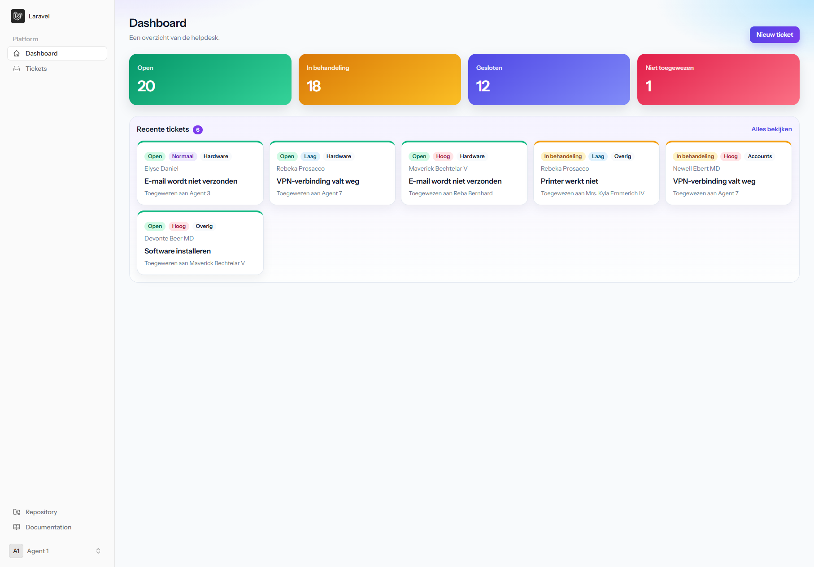
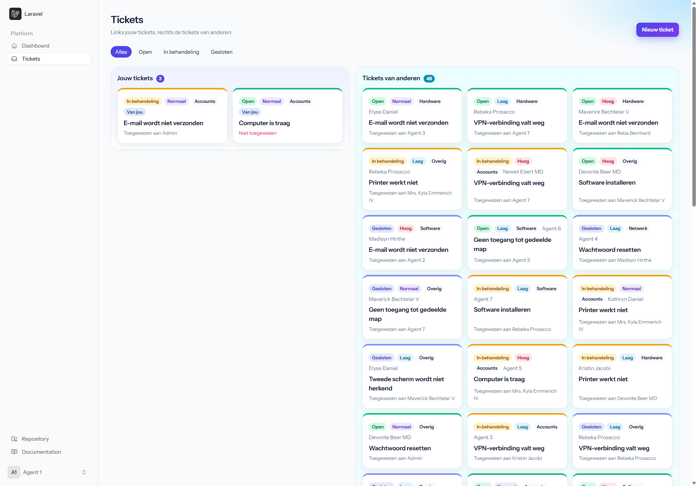
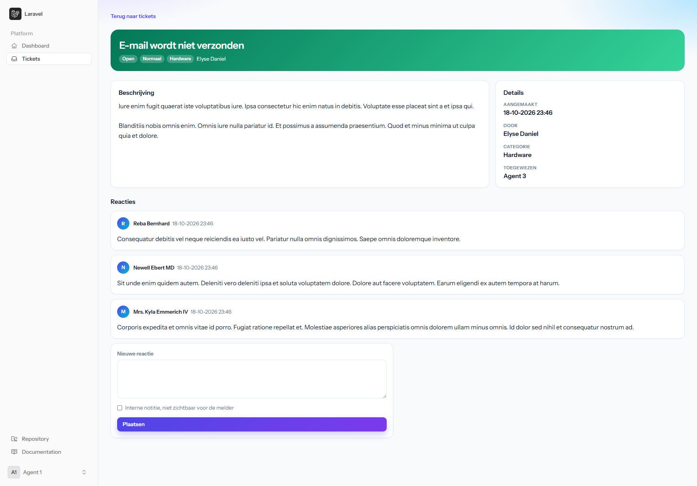
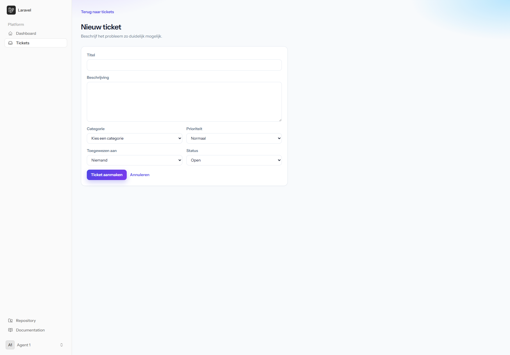

# Ticket-Systeem

Helpdesk voor IT-meldingen. Medewerkers maken een ticket, agents en admins werken de wachtrij af. De schermafbeeldingen hieronder laten de applicatie zien zonder dat je hem hoeft te installeren.

## Schermafbeeldingen

### Dashboard

Aantallen per status, plus de laatste tickets.



### Ticketoverzicht

Voor een agent of admin staan de tickets die aan hem zijn toegewezen links, onder **Aan jou toegewezen**. Daarnaast staan tickets die hij zelf maakte, en de overige tickets. Elke kaart toont status, prioriteit, categorie en aan wie het ticket is toegewezen.



### Ticket

Beschrijving, details en reacties. Een agent kan een interne notitie plaatsen die de melder niet ziet.



### Nieuw ticket



## Wat je ermee kunt

- Tickets aanmaken, bekijken, filteren, bewerken en verwijderen.
- Reageren op een ticket, ook met een interne notitie.
- Een ticket kan alleen worden toegewezen aan een agent of een admin. Alleen een admin wijst een ticket toe aan iemand anders. Een agent kan een niet-toegewezen ticket wel zelf overnemen.
- Drie rollen:
  - **Medewerker** ziet alleen eigen tickets en mag die bewerken en verwijderen.
  - **Agent** ziet alle tickets en kan een niet-toegewezen ticket overnemen. Bewerken mag bij een ticket dat hij zelf maakte, of dat aan hem is toegewezen. Hij wijst het niet toe aan een andere agent. De titel en beschrijving van de melder wijzigt hij niet. Verwijderen mag alleen bij een eigen ticket.
  - **Admin** mag elk ticket bewerken, toewijzen en verwijderen, en elke reactie verwijderen.

## Starten

Je hebt PHP 8.4, [Composer](https://getcomposer.org) en [Node.js](https://nodejs.org) nodig.

```bash
git clone https://github.com/John07-Coder/Ticket-Systeem.git
cd Ticket-Systeem
php -r "file_exists('database/database.sqlite') || touch('database/database.sqlite');"
composer run setup
php artisan db:seed
php artisan serve
```

Open daarna [http://127.0.0.1:8000](http://127.0.0.1:8000).

`composer run setup` maakt het `.env`-bestand, de applicatiesleutel, de database en de CSS. `db:seed` vult de database met categorieën, gebruikers, 50 tickets en reacties.

## Inloggen

Elk geseed account gebruikt het wachtwoord `password`.

| Rol | E-mail |
| --- | --- |
| Admin | `test@example.com` |

Agents en medewerkers krijgen een willekeurig e-mailadres. Die lijst zie je met:

```bash
php artisan db:table users
```

Een nieuw account via de registratiepagina wordt een medewerker.

## Tests

```bash
php artisan test
```
